# Pipeline de Dados com IoT e Docker

## Relatório acadêmico final

**Aluno:** Victor Matos

**Disciplina:** Disruptive Architectures: IoT, Big Data e IA

**Data:** 10 de outubro de 2026

**Aplicação:** IoT Thermal Analytics | Victor Matos

Relatório elaborado a partir dos arquivos, capturas e registros reais deste projeto. As verificações de execução documentadas ocorreram em 08 e 10/10/2026. A preparação deste documento após o reinício do computador não repetiu cargas, não consultou o banco nem iniciou Docker ou Streamlit. Portanto, resultados de execução são evidências das validações registradas, e não uma afirmação de disponibilidade atual dos serviços.

## Resumo

Este projeto implementa um pipeline de leituras reais de temperatura obtidas no dataset Temperature Readings: IoT Devices, disponibilizado no Kaggle por atulanandjha. O processamento em Python utiliza pandas, SQLAlchemy e psycopg2-binary; o armazenamento ocorre no PostgreSQL 16 executado em Docker; as análises são expostas por três views SQL e apresentadas em Streamlit com Plotly. O arquivo original contém 97.606 registros. A carga preserva todas as linhas no staging, identifica uma duplicata exata e mantém 97.605 leituras únicas na camada tratada. Três execuções registradas demonstram idempotência da tabela tratada. A documentação registra testes de ingestão, nove testes de leitura das views e do dashboard e dezesseis verificações do conteúdo das quatro exportações CSV. O relatório apresenta arquitetura, regras de qualidade, resultados, evidências visuais e limitações. Não se infere unidade térmica, fuso horário, sensores físicos ou disponibilidade operacional a partir de campos que não permitem essas conclusões.

## 1. Contextualização e objetivos

Leituras associadas a aplicações IoT podem chegar com frequências irregulares, registros repetidos e formatos inadequados à análise direta. Transformar um CSV em gráficos sem preservar sua origem dificulta explicar exclusões, reprocessar cargas e comparar resultados. O problema tratado neste trabalho é construir uma cadeia verificável entre a fonte, o processamento, o banco e a visualização.

O objetivo geral é processar leituras de temperatura, armazená-las em PostgreSQL com Docker e disponibilizar análises interativas baseadas exclusivamente em registros reais. Os objetivos específicos são preservar o arquivo de origem; validar formatos explicitamente; separar dados brutos, tratados e auditoria; impedir duplicação em reexecuções; produzir três perspectivas analíticas distintas; e documentar o significado e os limites das métricas.

Embora o dataset seja identificado como IoT, a implementação recebe um arquivo histórico em lote. Não há captura ao vivo de dispositivos, broker MQTT ou integração com hardware. A disciplina contempla IoT, Big Data e IA, mas esta entrega não implementa aprendizado de máquina nem afirma processamento distribuído. Seu foco é a engenharia de ingestão, armazenamento e análise descritiva exigida no desafio.

## 2. Orientação acadêmica e correspondência da entrega

A orientação original, intitulada TRABALHO - Disruptive Architectures_ IOT, Big Data e IA.docx - Copy.pdf, foi localizada em Downloads e relida integralmente. Ela tem sete páginas. Os requisitos específicos do PDF estão na página 6; os outros entregáveis são descritos nas páginas 6 e 7. O documento não estabelece número mínimo de páginas, modelo de capa ou norma ABNT específica. Não foram inventados instituição, professor, matrícula ou turma.

| Exigência do PDF, página 6 | Atendimento neste relatório |
|---|---|
| Contextualizar o problema e a proposta do pipeline | Seções 1 e 3 |
| Descrever ambiente, dependências, Docker, banco, views e dashboard | Seções 3 a 8 |
| Explicar detalhadamente três views e seus propósitos | Seção 7 e apêndice SQL |
| Incluir prints das visualizações Streamlit | Anexo visual com cinco páginas e complementares |
| Apresentar insights e sugestões de uso prático | Seção 10 |

O roteiro acadêmico mostra exemplos de comandos Git globais, docker run e análises por device_id. O projeto utiliza identidade Git local, Docker Compose e os campos efetivamente presentes no dataset, mantendo o objetivo funcional sem inventar device_id. Os exemplos não foram tratados como instruções para alterar configurações globais, publicar o projeto ou criar sensores inexistentes. GitHub público e vídeo de até quatro minutos continuam como entregáveis separados e pendentes.

## 3. Arquitetura e organização

Fluxo de dados: CSV oficial preservado → leitura e SHA-256 → staging e auditoria → validação e reconciliação → tabela tratada → três views analíticas → consultas somente de leitura → dashboard e exportações CSV.

O processamento e o dashboard executam no ambiente virtual Python do projeto no Windows. Apenas PostgreSQL é executado no contêiner Docker. A separação por schemas distingue a reprodução dos valores de origem, o modelo tipado para análise e os metadados de cada carga. O dashboard consome views, sem executar ingestão, criar tabelas ou reaplicar SQL.

| Componente | Responsabilidade e arquivo |
|---|---|
| Fonte | data/IOT-temp.csv; origem oficial preservada |
| Ingestão | src/ingest.py; leitura, validação, carga e auditoria |
| Banco | docker-compose.yml; PostgreSQL 16 e armazenamento persistente |
| Análises | sql/views.sql; agregações diárias e horárias |
| Consultas e filtros | src/dashboard_data.py; snapshot de leitura e transformações |
| Interface | dashboard.py; páginas, indicadores, gráficos e CSV |
| Verificação | tests/; suítes de ingestão, views e dashboard |
| Evidências | docs/ e docs/screenshots/; resultados e capturas reais |

As bibliotecas de execução são pandas, sqlalchemy, psycopg2-binary, streamlit e plotly. Python 3.12.10, PostgreSQL 16.15, contexto Docker desktop-linux e Git disponível foram informados ou registrados nas etapas anteriores. As versões não representam nova consulta aos programas após o reinício. ReportLab e PyMuPDF foram instalados apenas no ambiente virtual para preparar e revisar esta documentação; não fazem parte do pipeline de execução.

## 4. Ambiente, Docker e proteção da configuração

O serviço postgres usa a imagem postgres:16. O Compose recebe as variáveis do arquivo .env local, exige senha definida e monta o volume postgres_data em /var/lib/postgresql/data. O contêiner deste projeto foi identificado nas validações anteriores como projeto_pipeline_vicmatos-postgres-1. Não foi recriado nesta etapa.

A porta interna é 5432. A publicação local utiliza 127.0.0.1 e POSTGRES_PORT, cujo padrão é 5432. Isso permite conexão das aplicações locais sem uma publicação em todas as interfaces de rede. O healthcheck usa pg_isready com usuário e banco definidos por variáveis; intervalo de 10 segundos, timeout de 5 segundos, cinco tentativas e período inicial de 10 segundos. Uma consulta SELECT version() confirmou PostgreSQL 16.15 na validação anterior. O resultado do healthcheck indica prontidão do banco, mas não comprova por si só a presença das views ou a qualidade dos dados.

Credenciais de conexão são lidas exclusivamente do .env. Esse arquivo e o ambiente .venv estão protegidos pelo .gitignore nas verificações registradas. .env.example documenta a configuração sem senha utilizável. SQLAlchemy recebe parâmetros de conexão sem imprimir a senha, e as mensagens de falha do dashboard não mostram o conteúdo sensível da exceção. Este relatório não incorpora .env nem credenciais.

Comandos de reprodução, a executar somente quando necessário e no projeto correto:

```powershell
docker --context desktop-linux compose config --quiet
docker --context desktop-linux compose up -d postgres
docker --context desktop-linux compose ps
.\.venv\Scripts\python.exe -m pip install -r requirements.txt
.\.venv\Scripts\python.exe -m src.ingest
.\.venv\Scripts\python.exe -m streamlit run dashboard.py --server.port 8501
```

Esses comandos estão documentados para reprodução; não foram executados para gerar o relatório. Reexecutar ingestão mantém a tabela tratada idempotente, mas acrescenta staging e auditoria. Não se deve remover o volume para retomar a aplicação. O endereço http://127.0.0.1:8501 é local e não substitui um link público de entrega.

## 5. Dataset e qualidade dos dados

Fonte oficial: https://www.kaggle.com/datasets/atulanandjha/temperature-readings-iot-devices. Arquivo utilizado: data/IOT-temp.csv. O intervalo observado é de 28/07/2018 a 08/12/2018. O identificador de local é Room Admin e as categorias de ambiente são In e Out. O campo de local não identifica sensores físicos individuais.

| Campo original | Preservação no staging | Campo tratado e tipo |
|---|---|---|
| id | Texto original | source_id TEXT, chave primária |
| room_id/id | Texto original, nome entre aspas no SQL | location_name TEXT |
| noted_date | Texto original | observed_at TIMESTAMP WITHOUT TIME ZONE |
| temp | Texto original | temperature SMALLINT |
| out/in | Texto original, nome entre aspas no SQL | environment TEXT, In/Out |

O conjunto possui 97.606 linhas de dados e 97.605 identificadores únicos, com uma duplicata exata. A validação registrada não deixou rejeições persistentes para o arquivo oficial. Isso demonstra aprovação nas regras implementadas, não prova que toda leitura represente uma medição fisicamente correta. O CSV não é editado para corrigir formatos ou remover registros.

O SHA-256 do arquivo é 2bf965701db96cd5788403d395a25d2dd7282bea24e317b7f7b157b7a02063d4. A ingestão calcula esse hash e compara com o valor esperado antes de carregar. Uma alteração do arquivo resulta em recusa da carga oficial. O hash identifica o arquivo auditado, mas não demonstra, isoladamente, veracidade física da fonte.

As datas exigem o padrão DD-MM-AAAA HH:MM, validado por expressão regular e datetime.strptime com %d-%m-%Y %H:%M. Temperaturas exigem representação inteira e intervalo de SMALLINT, de -32768 a 32767; esse intervalo é uma restrição de armazenamento, não um limite físico de operação. Campos ausentes ou vazios e ambientes fora de In/Out são rejeitados. Unidade térmica e fuso não foram confirmados documentalmente.

## 6. Ingestão transacional, auditoria e idempotência

A carga lê o CSV com pandas em modo textual, sem converter silenciosamente valores ausentes. Os nomes e valores originais são preservados em staging.temperature_raw. Cada linha recebe source_row correspondente à sua posição no arquivo, começando em 2 por causa do cabeçalho, e run_id para vincular a execução.

| Tabela | Finalidade |
|---|---|
| audit.ingestion_runs | Hash, arquivo, horários, status e contagens da carga |
| audit.ingestion_rejections | Linha rejeitada e motivo, vinculados ao staging |
| staging.temperature_raw | Valores originais de todas as linhas de cada execução |
| iot.temperature_readings | Leituras tipadas, ID único, local, data, temperatura e ambiente |

Um bloqueio consultivo transacional serializa as cargas. A inserção em lotes com psycopg2 participa da transação controlada pelo SQLAlchemy. Criação das estruturas, staging, rejeições, registros tratados e conclusão da auditoria são confirmados juntos. Erros técnicos revertem toda a transação; consequentemente, uma carga que falha tecnicamente não deixa seu registro de falha persistido nesta versão.

Duplicatas são detectadas pela igualdade dos cinco valores originais. A ocorrência adicional permanece no staging e é contabilizada como duplicata, sem nova leitura tratada. Observações simultâneas com IDs diferentes são preservadas. Variantes distintas de um mesmo ID no arquivo são rejeitadas, e um ID existente no banco só é considerado já carregado quando seu conteúdo tratado coincide. Conflitos recebem motivo auditável, em vez de sobrescrever medições.

A reconciliação exigida é: origem = duplicatas + rejeições + inseridos + já existentes. A aplicação valida a igualdade e a tabela de auditoria exige essa relação para status completed. A chave primária source_id impede duplicação da camada tratada. Staging e auditoria crescem a cada execução bem-sucedida, mesmo que nenhuma leitura nova seja inserida; idempotência refere-se à tabela tratada.

| Execução registrada | Origem | Duplicatas | Rejeições | Inseridos | Já existentes |
|---|---:|---:|---:|---:|---:|
| Primeira carga | 97.606 | 1 | 0 | 97.605 | 0 |
| Segunda carga | 97.606 | 1 | 0 | 0 | 97.605 |
| Terceira carga | 97.606 | 1 | 0 | 0 | 97.605 |
| Total auditado | 292.818 | 3 | 0 | 97.605 | 195.210 |

O registro final_integrity_check.json documenta três execuções concluídas, 292.818 linhas em staging, zero rejeições persistentes e 97.605 IDs únicos. As três ocorrências de duplicata representam a mesma duplicata contabilizada em três cargas, e não três duplicatas diferentes na fonte. O fingerprint de conteúdo db628f44918517e86003d1e23d9bcb7b permaneceu igual nas verificações registradas. Esse MD5 serve à comparação de integridade entre etapas; não é uma assinatura de segurança.

## 7. Três views SQL analíticas

### 7.1 Resumo diário: vw_daily_temperature_summary

A view agrupa observed_at convertido em data, location_name e environment. Retorna temperatura mínima, máxima, média, amplitude e reading_count. A amplitude é máxima menos mínima. A média é calculada sobre as leituras do grupo; não representa ponderação por duração. O resultado validado possui 158 grupos. As contagens somadas reconciliam 97.605 leituras.

Exemplo real: em 28/07/2018, Room Admin, In, foram registradas 45 leituras, todas com temperatura 31. Mínimo, máximo e média são 31; amplitude é zero. Esse resultado descreve os registros disponíveis daquele dia e ambiente, sem concluir estabilidade contínua durante as horas sem observações.

Uso analítico: comparar variação diária entre ambientes, localizar dias de maior amplitude e contextualizar extremos com a quantidade de leituras. Ao resumir vários grupos, a média correta é a soma de média do grupo vezes contagem, dividida pela soma das contagens. Uma média simples das médias daria o mesmo peso a grupos de volumes diferentes.

### 7.2 Cobertura: vw_hourly_sampling_coverage

A view agrupa data, hora inteira de 0 a 23, local e ambiente. Retorna reading_count, observed_minutes, minute_coverage_pct, has_unobserved_minutes e additional_readings_in_observed_minutes. A contagem de minutos usa timestamps truncados ao minuto e distintos dentro do grupo. A cobertura é observed_minutes × 100 / 60. O resultado validado possui 2.287 grupos, cuja soma das leituras também é 97.605.

Exemplo real: em 28/07/2018 às 07h, Room Admin, In, há 45 leituras em 7 minutos distintos. A cobertura é aproximadamente 11,6667%, e há 38 leituras além da primeira em minutos já observados. Elas não são classificadas como duplicatas por compartilharem minuto. Há 2.265 grupos com menos de 60 minutos observados e 717 com leituras adicionais em minutos observados.

A view só retorna horas com registros. Não cria horários ausentes nem preenche medições. O denominador é sempre 60, inclusive em horas parciais nas extremidades do arquivo. A métrica descreve distribuição temporal dos registros, não disponibilidade comprovada do sensor. Pode orientar uma investigação da coleta, mas não diagnosticar indisponibilidade de hardware.

### 7.3 Comparação: vw_hourly_indoor_outdoor_gap

A view agrupa timestamp truncado à hora e local. As médias de In e Out são calculadas separadamente com agregações filtradas e acompanhadas de suas contagens. HAVING mantém somente horas com registros nos dois ambientes. O resultado contém 865 grupos comparáveis. Não há JOIN entre leituras brutas; assim, a comparação não multiplica registros por combinações entre ambientes.

A convenção é outdoor_minus_indoor = média externa − média interna. Um resultado positivo indica média externa maior. Em 28/07/2018 às 07h, Room Admin, a média interna é 31, com 45 leituras; a média externa é 31,7906976744186047, com 43 leituras. A diferença é 0,7906976744186047. Os valores resultam de somas 1.395 e 1.367 divididas pelas respectivas contagens.

As médias são ponderadas por leituras em cada ambiente. Estar na mesma hora não garante simultaneidade dos registros, e frequências distintas podem influenciar a comparação. Horas com apenas um ambiente são excluídas. A diferença não demonstra causalidade ou eficiência térmica de uma edificação. As três views utilizam CREATE OR REPLACE VIEW compatível e deixam a ordenação para as consultas consumidoras.

## 8. Dashboard e interpretação dos indicadores

A aplicação IoT Thermal Analytics | Victor Matos oferece cinco páginas: Visão geral, Temperaturas diárias, Cobertura das leituras, Comparação In/Out e Qualidade e limitações dos dados. Streamlit organiza a navegação, os filtros, indicadores e tabelas; Plotly oferece gráficos interativos. As quatro páginas analíticas permitem baixar suas tabelas em CSV.

Filtros de período são inclusivos por dia. Ambientes podem ser selecionados individualmente, mas a comparação exige In e Out. Períodos sem registros, nenhum ambiente selecionado ou ausência de horas comparáveis produzem mensagens explicativas. Não são inventadas medições para preencher lacunas. Os gráficos de linha conectam observações disponíveis, sem representar medições intermediárias.

Os indicadores usam o resumo diário: soma de reading_count, menor mínimo, maior máximo e média ponderada por contagens. Com todos os dados, são exibidos 97.605 registros, mínimo 21, máximo 51 e média 35,0539, arredondada a quatro casas. A média não arredondada registrada é 35,0538599456995. Esses valores não recebem unidade Celsius. Na comparação, os indicadores superiores descrevem todas as leituras filtradas; o gráfico usa somente horas com os dois ambientes.

As consultas são executadas em transação READ ONLY e REPEATABLE READ, com limite de 15 segundos por consulta. O cache tem TTL de 60 segundos e botão Atualizar dados. O horário da consulta é informado em UTC; esse fuso não é atribuído às observações do arquivo. Erros de conexão são tratados por mensagem segura. Um snapshot em cache pode permanecer visível por até 60 segundos.

As capturas incorporadas são reais e foram conferidas pelo título, menu e conteúdo. Os arquivos passaram por validação PNG e decodificação. Prints mostram trechos de página em diferentes posições de rolagem; as complementares preservam gráficos, tabelas e avisos que não cabem na captura principal. Nenhuma imagem foi montada, sintetizada ou criada para representar resultados inexistentes. Uma captura estática não demonstra os gestos de interação do Plotly.

## 9. Testes e evidências de verificação

| Validação registrada | Resultado e alcance |
|---|---|
| Ingestão | Três testes aprovados historicamente; carga, idempotência, reconciliação, linha inválida, conflitos e rollback |
| Views | Quatro testes aprovados; grupos, médias, extremos, minutos, unicidade e integridade |
| Dashboard | Cinco testes aprovados; consultas, indicadores, cinco páginas, filtros vazios e erro seguro |
| Suíte de leitura final | Nove testes aprovados em 39,258 segundos em 10/10/2026 |
| Exportações CSV | Dezesseis verificações aprovadas: quatro arquivos em quatro cenários |
| Interface visual | Revisão manual das cinco páginas declarada pelo usuário; capturas reais conferidas |
| HTTP anterior | Raiz e endpoint de saúde responderam 200; saúde retornou ok |

Os testes das views agregam leituras reais em Python e comparam todos os grupos com SQL, evitando depender da própria view como única referência. Amostras também foram conferidas com consultas independentes na tabela. Streamlit AppTest verifica componentes e estados das páginas, mas não equivale a uma sessão visual completa em navegador. Os avisos de contexto e cache na execução de testes não impediram sua aprovação.

Os casos inválidos de ingestão usam cópias em memória de registros reais e transações revertidas, sem editar o CSV original. A descoberta geral de testes não foi reexecutada para este relatório porque a suíte de ingestão grava auditoria. As evidências de execução anteriores permanecem com suas datas; não foram apresentadas como testes realizados novamente após o reinício.

### 9.1 Exportações CSV: dezesseis verificações técnicas

Foram conferidos o payload entregue pela função real de exportação ao botão, os nomes, os cabeçalhos, a decodificação UTF-8 estrita com BOM, a quantidade de registros e a igualdade do conteúdo com consultas SQL independentes para os mesmos filtros. O separador é vírgula e não há coluna de índice. A cobertura inclui hour_timestamp, derivado da data e hora no dashboard e conferido na referência.

| Cenário e filtros inclusivos | resumo_diario.csv | temperaturas_diarias.csv | cobertura_horaria.csv | comparacao_horaria.csv |
|---|---:|---:|---:|---:|
| 28/07 a 08/12/2018, In e Out | 158 | 158 | 2.287 | 865 |
| 01 a 10/08/2018, In e Out | 3 | 3 | 7 | 3 |
| 01 a 10/08/2018, somente In | 1 | 1 | 3 | 0 |
| 01 a 02/01/2020, In e Out | 0 | 0 | 0 | 0 |

Contagens excluem o cabeçalho e representam grupos analíticos, não linhas brutas de origem. Nos estados vazios o dashboard não oferece download; nesses casos foi verificada apenas a serialização vazia da função. As dezesseis verificações são distintas dos nove testes da suíte de leitura.

Os quatro downloads CSV passaram nas 16 verificações automatizadas, mas NÃO foram conferidos manualmente no navegador. Ainda falta clicar em cada botão, confirmar gravação e nome do arquivo, abrir no Excel/LibreOffice/editor, verificar cabeçalhos, importação UTF-8, separador e contagens e repetir com um filtro reduzido. Essa pendência não foi encoberta por simulação de clique ou por screenshots.

## 10. Resultados, insights e uso prático

O primeiro resultado é a preservação de 97.605 leituras únicas, com uma duplicata exata explicada pela auditoria. Reprocessamentos não aumentaram a tabela tratada. Isso permite reproduzir análises sem apagar dados e demonstra a utilidade de separar idempotência analítica de crescimento do histórico de carga.

O intervalo total de temperaturas registradas vai de 21 a 51, com média por leitura de aproximadamente 35,0539. A diferença entre extremos é 30 na unidade não confirmada. A amplitude global não deve ser atribuída a um único dia ou ambiente. Para examinar contextos locais, o resumo diário reúne extremos e volume em cada grupo.

A amostragem temporal é desigual: 2.265 dos 2.287 grupos horários têm menos de 60 minutos observados, aproximadamente 99,04%. Esse percentual descreve somente horas presentes na view, não a totalidade de horas do calendário nem indisponibilidade. Em 717 grupos há mais de uma leitura por minuto observado. Muitas leituras podem coexistir com baixa dispersão temporal, como as 45 observações em apenas 7 minutos do exemplo real. Portanto, volume de registros não substitui cobertura temporal.

As 865 horas comparáveis viabilizam examinar diferenças In/Out sem preencher horários ausentes. A amostra de 28/07/2018 às 07h mostra média externa maior em cerca de 0,7907, mas não permite generalizar esse sinal a todo o período nem concluir uma causa. É necessário analisar o gráfico e suas contagens antes de formular uma interpretação mais ampla.

Em um ambiente real, o resumo diário poderia apoiar triagem de dias com amplitude incomum; a cobertura poderia orientar revisão da frequência de coleta e comparação com logs de transmissão; e a diferença In/Out poderia apoiar investigação do comportamento térmico junto de dados de ocupação e climatização. Essas aplicações são propostas, não operações implementadas. Alertas exigiriam confirmação da unidade, limites operacionais, identificação dos sensores e definição da frequência esperada.

Os diferenciais desta solução são rastreabilidade por linha e execução, preservação textual do staging, reconciliação obrigatória, conflitos de ID tratados sem sobrescrita, comparação antes de qualquer combinação de registros e distinção explícita entre cobertura observacional e disponibilidade. A solução não depende de inferir equipamentos ou copiar modelos de outros alunos para produzir interpretações úteis.

## 11. Limitações e possibilidades de evolução

O dataset não identifica sensores físicos individuais. Room Admin representa local, e In/Out representa ambiente. Unidade térmica e fuso não estão confirmados: não se presume Celsius nem se convertem datas para UTC. As médias são ponderadas por registros e podem refletir coleta irregular; não equivalem a médias ponderadas pelo tempo.

Ausência de observações não distingue dispositivo desligado, falha de comunicação, coleta intermitente ou recorte do arquivo. O denominador de cobertura é 60 mesmo em horas parciais. Comparações horárias não garantem simultaneidade nem causalidade. Linhas entre pontos não demonstram medições realizadas no intervalo.

A implementação é local e em lote. Não há validação de escala Big Data, pipeline distribuído, modelo de IA, autenticação de dashboard ou hospedagem pública. A camada de staging cresce por execução, exigindo política de retenção futura. Falhas técnicas revertidas não deixam registro persistente de falha de ingestão; logging externo seguro é uma evolução possível. O cache pode exibir dados de até 60 segundos antes da atualização.

Evoluções possíveis incluem retenção documentada, trilha externa de falhas, ingestão incremental com contrato de dados, metadados confiáveis de sensores/unidade/fuso e indicadores de frequência esperada. Só depois desses fundamentos seria adequado avaliar alertas operacionais ou modelos preditivos. Nenhuma dessas melhorias foi declarada implementada.

## 12. Conclusão e situação da entrega

O projeto atende ao objetivo técnico de integrar Python, Docker, PostgreSQL e Streamlit em um pipeline auditável com dados reais. As evidências registradas sustentam a transformação de 97.606 linhas originais em 97.605 leituras únicas, a idempotência em três execuções, três perspectivas SQL distintas e visualizações interativas com filtros. O significado das métricas é documentado para evitar conclusões indevidas sobre sensores, unidades e disponibilidade.

Este PDF reúne os itens teóricos da orientação original e as cinco capturas exigidas, com complementares. O teste manual dos quatro downloads continua pendente. Os registros de execução e HTTP anteriores não garantem que os serviços estejam ativos após o reinício. Para entregar a parte prática, ainda é necessário revisar o README, vincular capturas, autorizar publicação do repositório e confirmar seu acesso público. O endereço GitHub informado pelo usuário não foi declarado publicado ou validado nesta etapa.

O vídeo pitch de até quatro minutos ainda precisa ser produzido e publicado em canal permitido pela orientação, com link acessível. Não foram executados commit, push ou publicação para elaborar este documento. A geração do PDF não significa que os três entregáveis acadêmicos estejam concluídos.

## Referências e rastreabilidade

Orientação acadêmica original: TRABALHO - Disruptive Architectures_ IOT, Big Data e IA.docx - Copy.pdf, sete páginas; documento fornecido pelo usuário. Cópia preservada em docs/orientacao_academica_original.pdf, com conferência de SHA-256.

ATULANANDJHA. Temperature Readings: IoT Devices. Kaggle. Fonte oficial do CSV: https://www.kaggle.com/datasets/atulanandjha/temperature-readings-iot-devices. A análise usa o arquivo local auditado; não foi feita nova coleta de dados para redigir o relatório.

Código inspecionado: src/ingest.py, src/dashboard_data.py, dashboard.py, sql/views.sql, docker-compose.yml e tests/. As descrições de comportamento foram conferidas nesses arquivos, sem alterá-los.

Evidências de execução: docs/views_validation.md; docs/dashboard_validation.md; docs/dashboard_test_results.txt; docs/final_evidence_tests.txt; docs/final_integrity_check.json; docs/visual_csv_validation.json. Inventário visual: docs/screenshots/evidence_inventory.json. Esses documentos mantêm seus registros históricos; campos antigos de screenshots vazios foram superados pelo inventário visual posterior, e não representam ausência atual de imagens.

## Apêndice A. SQL efetivamente implementado

O bloco a seguir reproduz sql/views.sql. As definições foram documentadas sem reaplicá-las ao banco. A primeira view agrupa por dia; a segunda por hora e ambiente; a terceira calcula as médias de ambos os ambientes no mesmo agrupamento, sem JOIN das observações brutas.

```sql
-- Victor Matos: análises por local e ambiente, sem inferir sensores individuais.
-- Unidade térmica e fuso horário não confirmados na fonte.
-- Ordenar nas consultas consumidoras, nunca depender da ordem da view.

CREATE OR REPLACE VIEW iot.vw_daily_temperature_summary AS
SELECT observed_at::date AS observation_date,
       location_name,
       environment,
       MIN(temperature) AS min_temperature,
       MAX(temperature) AS max_temperature,
       AVG(temperature) AS avg_temperature,
       MAX(temperature) - MIN(temperature) AS temperature_range,
       COUNT(*) AS reading_count
FROM iot.temperature_readings
GROUP BY observed_at::date, location_name, environment;

-- Cobertura: minutos distintos com registros / 60; não é uptime do sensor.
-- Só retorna horas observadas. Múltiplas leituras no mesmo minuto são preservadas.
CREATE OR REPLACE VIEW iot.vw_hourly_sampling_coverage AS
SELECT observed_at::date AS observation_date,
       EXTRACT(HOUR FROM observed_at)::integer AS observation_hour,
       location_name,
       environment,
       COUNT(*) AS reading_count,
       COUNT(DISTINCT DATE_TRUNC('minute', observed_at)) AS observed_minutes,
       COUNT(DISTINCT DATE_TRUNC('minute', observed_at)) * 100.0 / 60
           AS minute_coverage_pct,
       COUNT(DISTINCT DATE_TRUNC('minute', observed_at)) < 60
           AS has_unobserved_minutes,
       COUNT(*) - COUNT(DISTINCT DATE_TRUNC('minute', observed_at))
           AS additional_readings_in_observed_minutes
FROM iot.temperature_readings
GROUP BY observed_at::date, EXTRACT(HOUR FROM observed_at)::integer,
         location_name, environment;

-- Agrega antes de comparar. Diferença positiva: média externa maior que interna.
-- Horas sem ambos os ambientes são excluídas, não preenchidas nem interpoladas.
CREATE OR REPLACE VIEW iot.vw_hourly_indoor_outdoor_gap AS
SELECT DATE_TRUNC('hour', observed_at) AS observation_hour,
       location_name,
       AVG(temperature) FILTER (WHERE environment = 'In') AS indoor_avg_temperature,
       AVG(temperature) FILTER (WHERE environment = 'Out') AS outdoor_avg_temperature,
       AVG(temperature) FILTER (WHERE environment = 'Out')
         - AVG(temperature) FILTER (WHERE environment = 'In') AS outdoor_minus_indoor,
       COUNT(*) FILTER (WHERE environment = 'In') AS indoor_reading_count,
       COUNT(*) FILTER (WHERE environment = 'Out') AS outdoor_reading_count
FROM iot.temperature_readings
GROUP BY DATE_TRUNC('hour', observed_at), location_name
HAVING COUNT(*) FILTER (WHERE environment = 'In') > 0
   AND COUNT(*) FILTER (WHERE environment = 'Out') > 0;

```

## Anexo B. Capturas reais do dashboard

As figuras seguintes preservam os PNGs salvos no projeto. Cada captura ocupa uma página em orientação paisagem, respeitando a proporção original. As capturas principais mostram título, identificação e página selecionada; as complementares registram gráficos e conteúdo abaixo da dobra. As diferentes datas de consulta visíveis fazem parte das capturas originais.

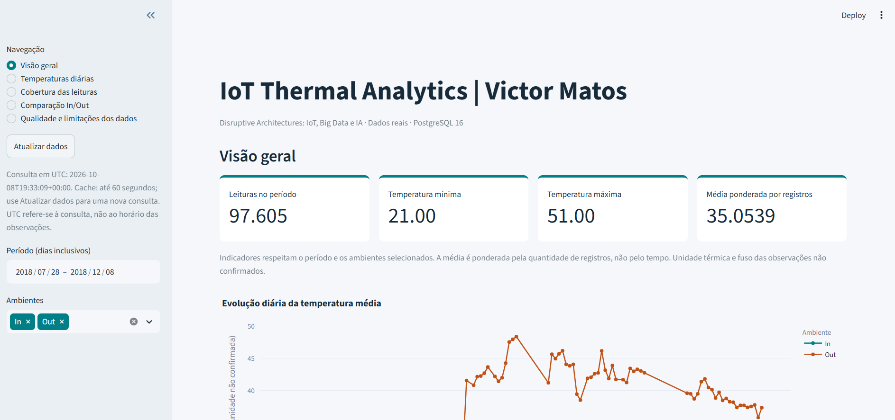
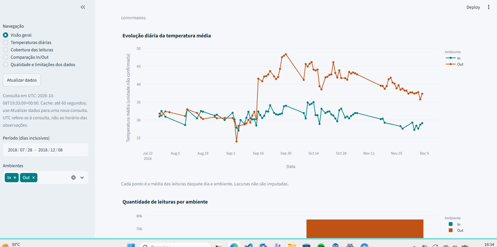
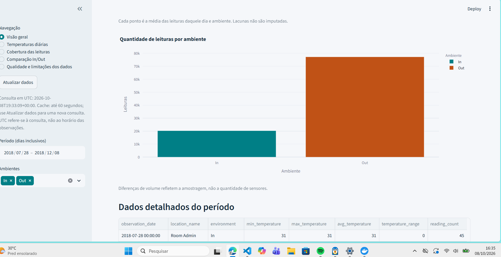
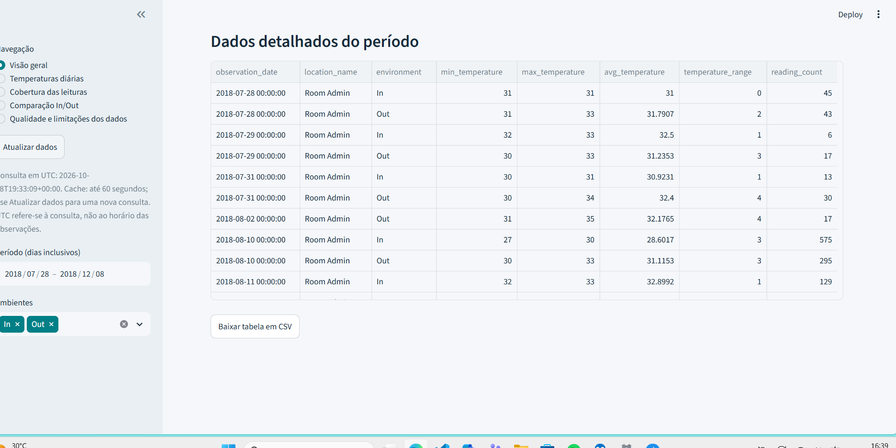
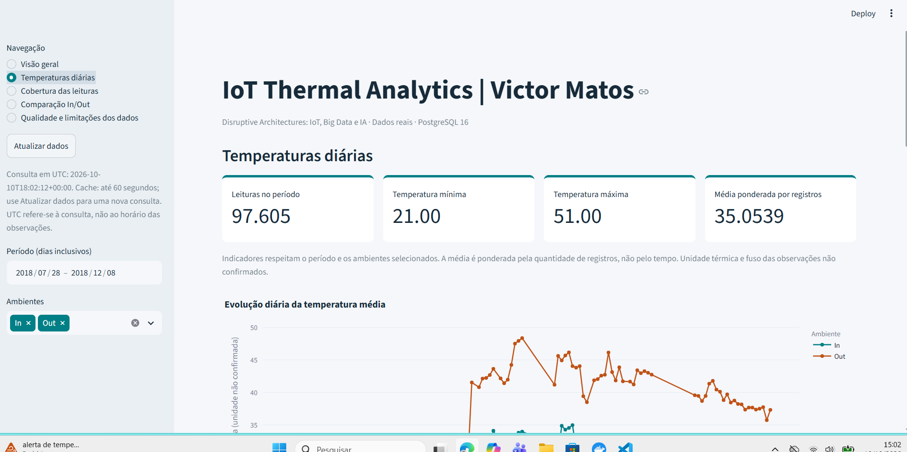
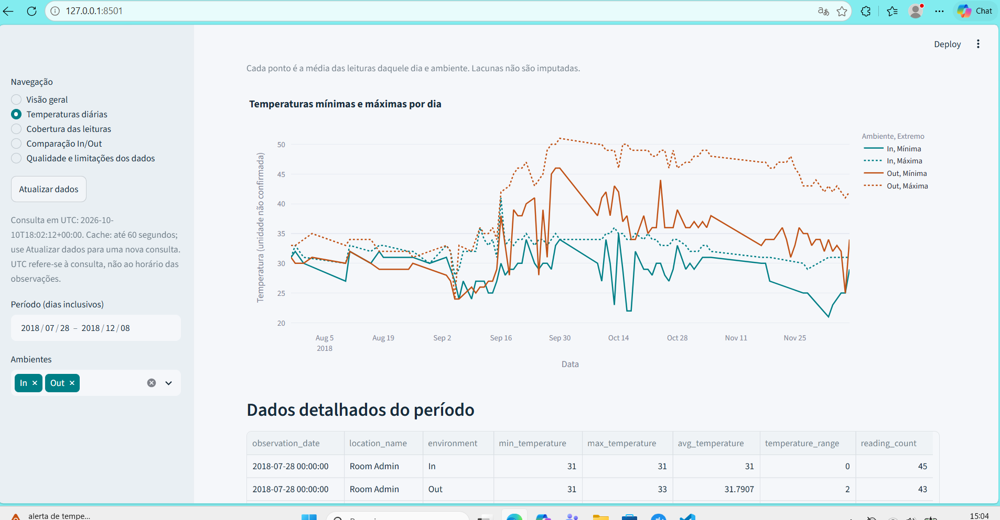
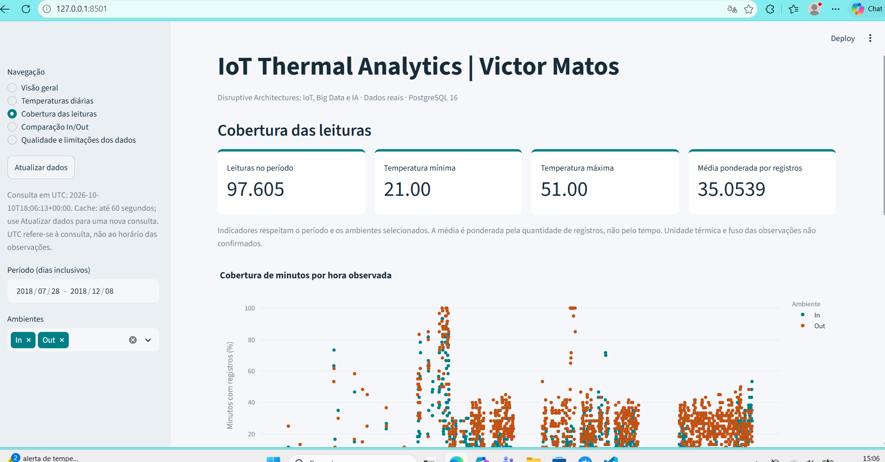
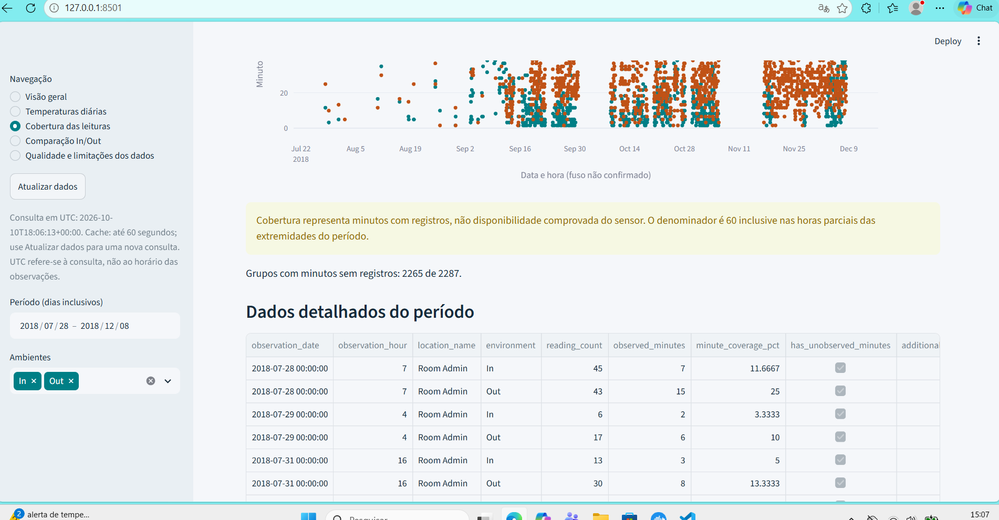
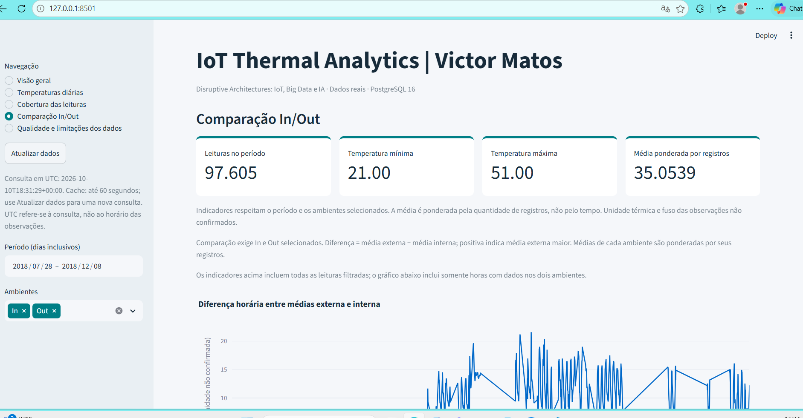
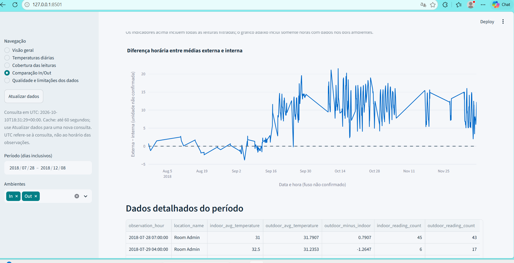
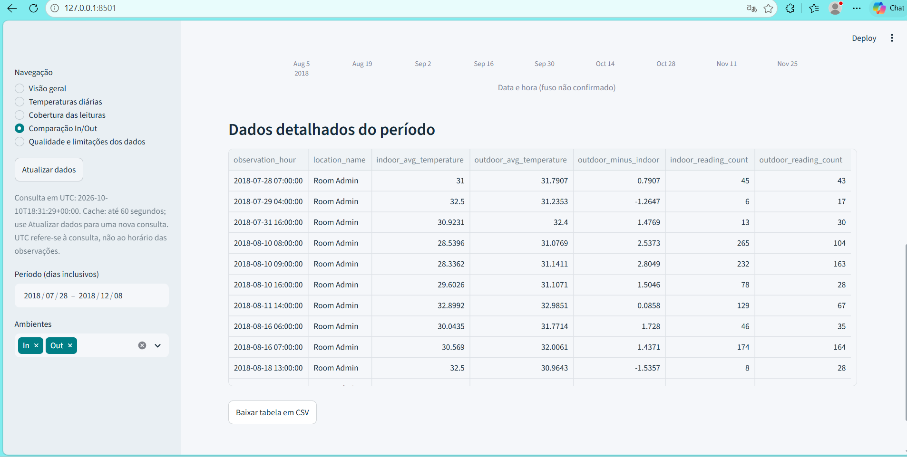
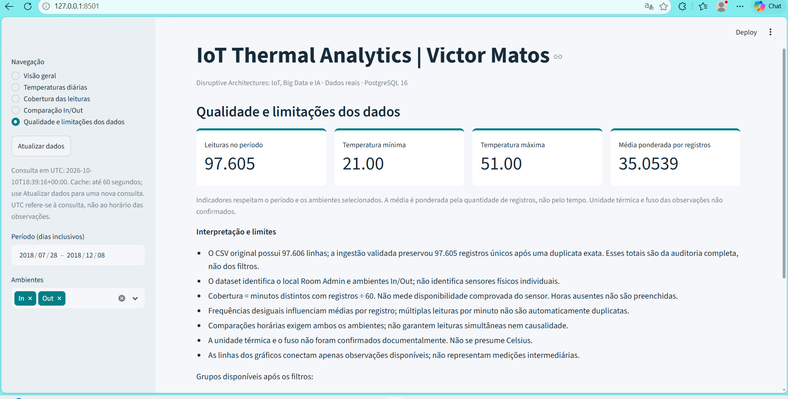
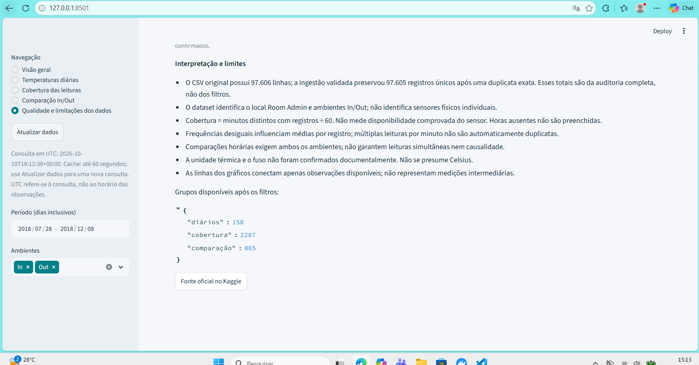
